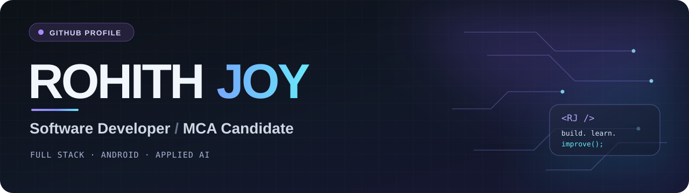

Hi there, I'm Rohith Joy 👋
Software Developer · MCA Candidate · Full-Stack, Android & Applied AI

Building practical software for real-world needs.

👨‍💻 About Me
I'm an MCA student and aspiring software developer based in Kerala, India, interested in full-stack applications, native Android development, and applied AI. I enjoy building practical systems, understanding how they work end to end, and improving the experience for the people using them.
- 🎓 Pursuing a Master of Computer Applications at Adi Shankara Institute of Engineering & Technology, Kalady.
- 🛠️ Working with Python, Java, React, Next.js, Django, Kotlin, and databases.
- 🤖 Exploring audio analysis, deep learning, and explainable AI through my MCA project, VoiceCare AI.
- 🌐 Contributed as a co-developer to the PRAGYAN 2026 college tech-fest website.
- 🎯 Interested in software engineering opportunities, internships, and collaborative development.

<b>⚡ A quick developer snapshot</b>

 name: Rohith Joy
location: Kerala, India
education: Master of Computer Applications (MCA) — pursuing
interests:
  - Full-Stack Web Development
  - Native Android Applications
  - Artificial Intelligence & Machine Learning
  - Explainable AI
current_focus:
  - VoiceCare AI
  - Software development and practical projects
open_to:
  - Full-time software development roles
  - Internships
  - Collaborative projects

🧰 Tech Stack
Languages

Web & Backend

Android, AI & Data

Tools

🚀 Featured Projects
🎙️ VoiceCare AI — Explainable AI for Voice Disorder Detection
MCA Major Project · Android · Python · AST · Explainable AI · Supabase

An AI-assisted voice-disorder screening project that processes speech recordings and uses an Audio Spectrogram Transformer (AST) to classify voice samples. The system explores interpretable audio visualizations and includes a native Android interface for users and a separate administrative web portal.
- Speech capture, preprocessing, and Mel-spectrogram-based analysis.
- Multi-class classification: Healthy, Inflammatory, Mobility, and Functional.
- Confidence scores and explainability-oriented visual feedback.
- User-facing Android app and administrator-facing web portal.
Explore the admin portal source · Read the project overview
🎟️ PRAGYAN 2026 — College Tech-Fest Website
Collaborative Web Development · Event Platform · Co-developer

Contributed to the official website for PRAGYAN 2026, supporting the online presence of the MCA technical fest. This was a collaborative project; my role was co-developer.

Visit the live website · See it in my portfolio
🏥 MediEase — Healthcare Services Management
Django · Python · MySQL · Web Application

A healthcare management application focused on coordinating services and making administrative workflows more manageable, with modules for customer-facing and service-provider activities.

Explore in my portfolio
🍽️ Catering Management System — Booking & Operations
PHP · MySQL · Web Application

A web-based catering management project for organizing event catering bookings, customer requests, and related administrative tasks.

Explore in my portfolio
💻 Developer Portfolio
Next.js · React · TypeScript · Tailwind CSS · GSAP · React Bits

My personal portfolio showcasing projects, skills, education, and certifications. The site includes animated interactions, responsive project browsing, and an interactive certificate gallery.

Source code · Portfolio website
🎓 Education
Qualification	Institution	Period	Details
Master of Computer Applications (MCA)	Adi Shankara Institute of Engineering & Technology, Kalady	2025–Present	Pursuing
Bachelor of Computer Applications (BCA)	DePaul Institute of Science & Technology, Angamaly	2022–2025	75%
Higher Secondary Education	Government Boys Higher Secondary School, Aluva	2020–2022	90%
Secondary School Leaving Certificate (SSLC)	Vijnanapeedom English Medium High School, Edanad	2020	98%

🏅 Certifications & Learning
Certification	Issuer	Completed	Achievement
The Joy of Computing using Python	NPTEL · IIT Madras	Jan–Apr 2026	Elite + Gold · 90%
Full-Stack MERN Application Development	GP3 Cloud Innovations	Jan 2026	Course certification
Full Stack Development Using Java	Archon Solutions	Jan 2025	Course certification
Python & AI Basics Course	COZMEK	Jul 2023	Course certification
Cybersecurity Fundamentals	IBM SkillsBuild	Jun 2026	Course certification
Essentials: Your First Workflows	n8n Education Team	Jul 2026	Course certification

You can view certificate images and details on my portfolio.
🤝 Contact & Connect
I'm interested in software development opportunities, internships, and collaborating on useful projects. Feel free to reach out.
Channel	Contact
GitHub	github.com/Rohith9037
LinkedIn	linkedin.com/in/rohith-joy-8120a3331
Phone	+91 90374 27151
Gmail	rohithjoy2004@gmail.com
Instagram	instagram.com/rohith.joy_
Portfolio	rohith-portfolio-sable.vercel.app

Thanks for visiting! If a project catches your interest, I'd be happy to discuss it.

Designed with a graphite · violet · ice-blue palette · © 2026 Rohith Joy

